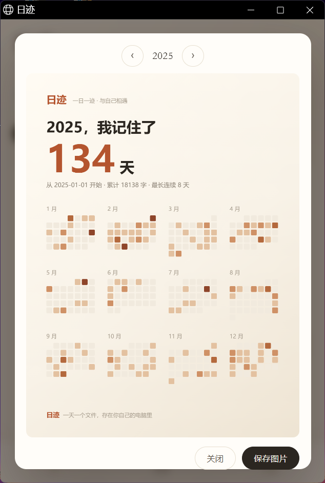

# 日迹 · 一天一页的日记

> 版本 1.2.2 · 纯本地，无账号、无 AI

本地优先的日记应用：一天一个 Markdown 文件，存在你自己电脑上。
没有账号、不上传、不联网。

## 截图

| 写日记 | 年度分享卡 |
|---|---|
|  |  |

## 特点

- **一天一页**，日历上点一格就写那一天
- **多话题**：一天里可以分几段写，各自有标题和标签
- **照片与涂鸦**：可拖动、缩放、旋转、锁定，也能在页面上画
- **封存**：给某一天上密码锁
- **分享卡**：把一年写成一张图
- **纯本地**：数据在 `data/` 里，Markdown 格式，记事本就能打开

## 运行

需要 Python 3.9+（只用标准库，无需 pip 安装）。

```bash
python app/server.py --data ./data --port 8802 --app
```

Windows 上直接双击根目录的 `启动.bat`（调用 `pythonw`，不弹命令行）。

## 目录

```
启动.bat          Windows 启动
app/              全部代码
  server.py       本地服务
  journal.py      读写 Markdown
  web/index.html  界面
  web/icons/      图标
  tests/          测试（python tests/test_journal.py）
```

打开后是一个本地网页应用，默认窗口 520×760。

## 数据

```
data/
  days/2026-10/2026-10-20.md     一天一个文件
  assets/2026-10-20/*.png        当天的照片
  index.json                     缓存
  settings.json                  设置
```

一天的 Markdown 长这样：

```markdown
---
date: 2026-10-20
words: 43
photos: [{"src":"2026-10-20/abc.png","topic":"t1"}]
---
# 2026年10月20日

## 话题 1 #小说

正文……
```

## 数据安全

- 保存时**绝不删除**已有内容；清空需要显式确认
- 写过的日子可以改写，但不会自动消失
- 建议定期用「导出」备份（设置 → 数据 → 导出 zip）

## 许可

MIT
